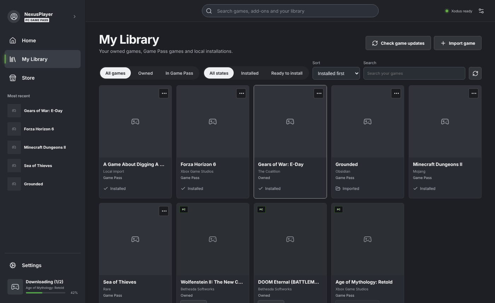

<div align="center">


# Xodus Nexus K

Your Microsoft Store PC games, on Linux.

[](https://github.com/BounciestSky152/xodus-nexus-kay/actions/workflows/ci.yml)
[](LICENSE)

</div>

> [!CAUTION]
> **Xodus Nexus is an independent, unofficial project built on Xodus. It is not an official project or release from the upstream Xodus developers.**
>
> Xodus Nexus K is a fork of [Xodus Nexus](https://github.com/domsvoboda/xodus-nexus) with its own changes, such as Game Pass tier sorting.
>
> Please report issues with this fork in the [Xodus Nexus K repository](https://github.com/BounciestSky152/xodus-nexus-kay/issues), not in the upstream Xodus issue tracker or support channels.
>
> Nexus includes its own changes, so a problem in Nexus does not necessarily indicate a problem in upstream Xodus.

An Xbox-inspired launcher built on [Xodus](https://github.com/xodus-gaming/xodus),
using our patched Nexus backend and Nexus runtime.
Browse the Store, install games you own or can access through a subscription,
and play with one shared runtime. Xbox sign-in and cloud saves are available
for supported games.



*Preview with sample account data.*

## Install

This fork does not publish releases. Build its AppImage from source on x86_64
Linux with Node.js 22 and Git:

```sh
git clone https://github.com/BounciestSky152/xodus-nexus-kay.git
cd xodus-nexus-kay
npm ci
npm run dist
```

Then make `release/Xodus-Nexus-*-x86_64.AppImage` executable and open it.
Launcher updates check this fork's [releases](https://github.com/BounciestSky152/xodus-nexus-kay/releases),
so none are offered until it publishes one. The AppImage from the original
[Xodus Nexus releases](https://github.com/domsvoboda/xodus-nexus/releases) does not
include this fork's changes.

In **Settings**, install the **Nexus backend** and **Nexus runtime**, then sign in
with your Microsoft account. A valid game purchase or subscription is required.

If passkey sign-in gets stuck, choose **Continue in browser** in the sign-in
window. This option requires Google Chrome, either a native installation or the
Flatpak version available through Discover. Other browsers are not supported.

[Setup guide and SteamOS requirements](https://github.com/domsvoboda/xodus-nexus/wiki/Getting-started)

## Use

- **My Library** combines owned, Game Pass and installed games, with Access, Play state and title filters.
- Open a game for its description, categories, screenshot gallery and available Xbox achievements, time played and last activity. Xbox data depends on the account and game.
- **Store** lets you browse and install supported PC games.
- Sort My Library or Store search results by **Game Pass tier** to order games by the cheapest plan that includes them on PC.
- **Manage content** installs licensed add-ons and campaign packages.
- **Install Queue** downloads games one at a time and lets you add more while downloading or playing another game. Pause and resume are supported, including manual resume after restarting the launcher.
- Cancelling a new installation can keep or delete its partial files. Existing games, updates and DLC keep their files.
- Right-click an installed game for settings, VC++ prerequisites, shortcuts or removal.
- Removing a game can keep its files or permanently delete its installation folder without using Trash. Saves inside that folder are deleted too; saves elsewhere are not affected.
- Game settings offer an optional **DualSense compatibility mode** if a standard DualSense is not detected. It applies only to that game and may disable advanced haptics and adaptive triggers.
- Choose **Add to Steam** in the game menu, or **Add Nexus to Steam** in Settings, to create a Non-Steam shortcut with available artwork. Steam can stay running, including in Game Mode. Requires native Linux Steam; Flatpak Steam is not yet supported.
- Update the launcher, backend and runtime in **Settings**.
- **Settings → Downloads** sets a combined game download speed limit in MiB/s (0 means unlimited). A supporting Nexus backend is required; saving the limit also applies it to active downloads.
- For account, library or installation errors, use **Settings → Xodus backend → Open backend diagnostic log**. The local log contains safe error codes and operation results, not credentials. Review it before sharing.

The system keyring (KDE Wallet or GNOME Keyring) stores your Microsoft sign-in
credentials so you do not need to sign in each time. It must be enabled and
unlocked, with Secret Service support. The first-run wizard and account Settings can check
the service and start an installed provider (`busctl` is needed for these checks).
On KDE, enable the wallet in **System Settings → KDE Wallet** if it was disabled.
Complete wallet setup and unlock it in Desktop Mode before using Steam Game Mode,
where password prompts may not be visible. Keep the wallet password enabled;
Nexus does not change passwords, reset credentials or install a provider.

Experimental gamepad navigation supports standard-mapped controllers: D-pad or
left stick to move, A to select, B to go back, X for a game's menu, LB/RB to
switch pages and the right stick to scroll. Mouse, touch and keyboard controls
remain available. Moving through library games selects them; A opens a game page
and B returns to its card. B closes an open menu or screenshot gallery first;
LB/RB changes screenshots inside the gallery. Home, My Library and Store
switch on controller focus. Recent games, Settings, Install Queue and action
buttons still require A. Up from the first library row reaches filters and search;
Down returns to the games. Directional navigation scrolls the selected card into view.
Use Steam + X for the on-screen keyboard in Game Mode;
system file pickers and sign-in windows may still need mouse or touch input.

[Documentation](https://github.com/domsvoboda/xodus-nexus/wiki) ·
[Report an issue](https://github.com/BounciestSky152/xodus-nexus-kay/issues)

## How it works

| Component | Role |
| --- | --- |
| Xodus Nexus | Store browsing, library, installation queue and launch controls. |
| Nexus backend | Patched build of [Xodus](https://github.com/xodus-gaming/xodus) for account sign-in, license checks, package downloads and launch preparation. |
| Nexus runtime | Built on [Xodus Proton](https://github.com/xodus-gaming/Proton) and [Xodus XGameRuntime](https://github.com/xodus-gaming/xgameruntime), with additional Nexus compatibility patches. |

Every game uses the same launch path and shared runtime.

## Screenshots

[Library](docs/screenshots/demo-library.png) ·
[Store](docs/screenshots/demo-store.png) ·
[Install queue](docs/screenshots/demo-downloads.png) ·
[Settings](docs/screenshots/demo-settings.png)

Independent project, not affiliated with Microsoft or Xbox. A valid game license
is required. Launcher: [MIT license](LICENSE). The separate Xodus backend retains
its upstream GPLv3 license and ships with corresponding source.
The Nexus runtime includes [FFmpeg](https://ffmpeg.org/) shared libraries under
LGPL 2.1 or later; its corresponding pinned source and build recipe accompany
each runtime release.
[Contributing](CONTRIBUTING.md)
